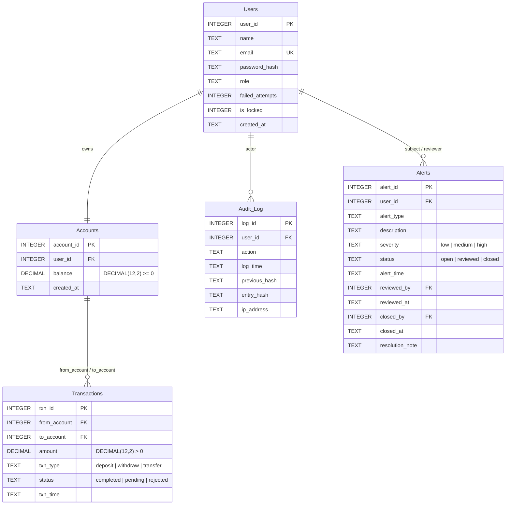

# Secure Banking System

[](https://github.com/ayushkulhari47/secure-banking-system-dbms-cyber/actions/workflows/tests.yml)
[](#)
[](#)
[](LICENSE)

An educational command-line banking ledger and security-controls prototype written in Python. It models core retail banking operations (deposits, withdrawals, transfers, balance lookups, and transaction history) alongside database-backed security controls including `bcrypt` password hashing, brute-force account lockout, data-layer role-based access control (RBAC), exact `Decimal` currency arithmetic, atomic transactions, Maker-Checker dual control for transfers above a configured threshold, a SHA-256 hash-chained `Audit_Log` protected by SQL triggers, automated security alerts, and SQLite hot backup/restore utilities.

> [!NOTE]
> This is an **educational prototype**, not a real banking system or production financial software. Live MySQL execution was **not** tested in this environment (see [Known Limitations](#known-limitations)).

---

## What the Application Does

The interactive CLI ([`main.py`](main.py)) authenticates users against the `Users` table and opens a role-scoped session with a 300-second monotonic inactivity timeout:

- **Standard users (`role='user'`)** can:
  - View their own account balance (`view_balance`)
  - Deposit funds into their own account (`do_deposit`)
  - Withdraw funds from their own account (`do_withdraw`), respecting pending outgoing transfer reserves
  - Transfer funds to another account (`do_transfer`) with self-transfer blocking:
    - Amounts `<= LARGE_TXN_THRESHOLD` (`Rs 50,000.00`) execute immediately and atomically
    - Amounts `> LARGE_TXN_THRESHOLD` create a `pending` Maker-Checker transfer without moving balances immediately
  - View transaction history for their own account (`view_transactions`)
  - Change their own password (`do_change_password`), subject to password complexity rules
- **Administrators (`role='admin'`)** have all user actions on their own account plus admin consoles for:
  - Viewing recent audit logs (`Audit_Log`)
  - Triaging and resolving security alerts (`open` -> `reviewed` -> `closed`)
  - Approving or rejecting `pending` Maker-Checker transfers (blocking non-admins, the transfer maker, and an admin recipient)
  - Listing and unlocking brute-force-locked user accounts (`is_locked = 0`, `failed_attempts = 0`)
  - Verifying the SHA-256 hash chain integrity across `Audit_Log`

---

## Security & DBMS Features

| Feature | Implementation & Behavior | Code Location |
|---|---|---|
| **bcrypt Authentication** | Salted `bcrypt` hashing (`BCRYPT_ROUNDS = 12`); constant-work verification including a runtime random dummy hash (`DUMMY_PASSWORD_HASH`) for unknown emails and generic `"Invalid email or password."` failure messages. | [`bank/auth.py`](bank/auth.py) |
| **Three-Attempt Lockout** | Consecutive failed logins increment `Users.failed_attempts`; on the 3rd failure (`MAX_FAILED_LOGINS = 3`), sets `is_locked = 1` and raises one high-severity `"Brute Force"` alert atomically. | [`bank/auth.py`](bank/auth.py), [`bank/config.py`](bank/config.py) |
| **RBAC & Ownership Enforcement** | Enforced both in the CLI and inside [`bank/`](bank/) data-layer functions (`get_account_by_id`, `get_transactions_for_account`, `deposit`, `withdraw`, `transfer`, `create_pending_transfer`, `change_password`, audit, alerts, unlock, approvals). | [`bank/transactions.py`](bank/transactions.py), [`bank/auth.py`](bank/auth.py), [`bank/audit.py`](bank/audit.py), [`bank/alerts.py`](bank/alerts.py) |
| **Decimal Money Handling** | Uses Python `Decimal` (`Decimal("0.01")` precision) end-to-end with `DECIMAL(12,2)` SQL columns and SQLite `CHECK(ROUND(balance, 2) = balance)` / `CHECK(ROUND(amount, 2) = amount)`. Rejects booleans, non-numeric strings, `NaN`, `Infinity`, `<= 0`, `> 2` decimal places, and `> MAX_AMOUNT`. | [`bank/security.py`](bank/security.py), [`bank/transactions.py`](bank/transactions.py), [`bank/db.py`](bank/db.py) |
| **Atomic Transactions** | Explicit `BEGIN IMMEDIATE` (SQLite) and `BEGIN` + `SELECT ... FOR UPDATE` in deterministic `account_id` order (MySQL), with safe rollback on error so partial debits/credits, transactions, audit entries, or alerts cannot persist. | [`bank/db.py`](bank/db.py), [`bank/transactions.py`](bank/transactions.py) |
| **Maker-Checker Transfers** | Transfers strictly above `LARGE_TXN_THRESHOLD` (`Rs 50,000.00`) enter `'pending'`, reserve outgoing funds in available-balance calculations, bar non-admins, the maker, and any recipient admin from approving, re-verify available balance at approval, and release reserves on rejection. Deposits and withdrawals do not use Maker-Checker. | [`bank/transactions.py`](bank/transactions.py), [`main.py`](main.py) |
| **Audit Hash Chain** | Every `Audit_Log` row links `previous_hash` (starting from 64 zeroes `GENESIS_HASH`) to `entry_hash = SHA-256(previous_hash\|user_id\|action\|log_time)` inside the enclosing DB transaction, failing closed if the chain tail is corrupt or missing hashes. | [`bank/audit.py`](bank/audit.py) |
| **Append-Only `Audit_Log` Triggers** | SQLite and MySQL triggers (`after_accounts_balance_update`, `prevent_audit_log_update`, `prevent_audit_log_delete`) automatically hash-chain every `Accounts.balance` update and block `UPDATE` / `DELETE` on `Audit_Log`. | [`bank/db.py`](bank/db.py), [`sql/triggers.sql`](sql/triggers.sql) |
| **Large-Transaction Alerts** | High-severity `"Large Transaction"` alerts are created atomically inside the same DB transaction for successful deposits, withdrawals, and transfer requests strictly above `LARGE_TXN_THRESHOLD`; failed/rolled-back calls create no alerts. | [`bank/transactions.py`](bank/transactions.py), [`bank/alerts.py`](bank/alerts.py) |
| **Admin Unlock** | Only administrators can list locked accounts and unlock them (`unlock_user`), clearing `is_locked = 0`, resetting `failed_attempts = 0`, and recording an audit entry. | [`bank/auth.py`](bank/auth.py), [`main.py`](main.py) |

---

## Project Structure

```text
secure-banking-system-dbms-cyber/
├── .github/workflows/tests.yml   # GitHub Actions pytest CI (Python 3.10–3.13)
├── bank/
│   ├── __init__.py
│   ├── alerts.py                 # Security alert creation and open/reviewed/closed workflow
│   ├── audit.py                  # Atomic hash-chained Audit_Log writer & integrity verifier
│   ├── auth.py                   # bcrypt auth, dummy hash, lockout, password changes, admin unlock
│   ├── config.py                 # Env-driven DB config & centralized Decimal/security thresholds
│   ├── db.py                     # SQLite / mysql-connector-python abstraction, DDL, triggers
│   ├── security.py               # Decimal validation, safe CLI inputs, password policy, Session, velocity
│   └── transactions.py           # Ownership checks, atomic deposit/withdraw/transfer, Maker-Checker
├── scripts/
│   ├── seed_demo.py              # Explicit CLI script to seed demo users (no hardcoded passwords)
│   └── setup_mysql.py            # Optional MySQL provisioning & trigger installation helper
├── sql/
│   ├── schema.sql                # Reference SQLite DDL & triggers matching bank/db.py
│   ├── triggers.sql              # MySQL 8+ audit & append-only triggers matching bank/db.py
│   ├── procedures.sql            # Reference MySQL stored procedures
│   └── queries.sql               # Diagnostic reporting SQL queries (reference)
├── docs/                         # Supporting design, risk, backup, and test documentation
├── tests/                        # Automated pytest suite (240 tests)
├── main.py                       # Interactive CLI entry point
├── setup_db.py                   # Idempotent MySQL database, schema, trigger, and bank_app provisioner
├── backup_restore.py             # SQLite online backup / mysqldump + SHA-256 verification utility
├── verify_least_privilege.py     # Live MySQL runtime user privilege verification check
├── .env.example                  # Environment variable template (placeholders only)
├── requirements.txt              # External Python dependencies
├── SECURITY.md                   # Security disclosure policy & prototype notice
└── README.md
```

---

## Installation & Environment Setup

### 1. Prerequisites
- Python **3.10 or higher**

### 2. Clone and Create a Virtual Environment

```bash
git clone https://github.com/ayushkulhari47/secure-banking-system-dbms-cyber.git
cd secure-banking-system-dbms-cyber
```

Create and activate a virtual environment:

```powershell
# Windows (PowerShell)
python -m venv venv
.\venv\Scripts\Activate.ps1
```

```bash
# Linux / macOS
python3 -m venv venv
source venv/bin/activate
```

### 3. Install Dependencies

```bash
pip install -r requirements.txt
```

[`requirements.txt`](requirements.txt) installs:
- `bcrypt>=4.0.0,<5.0.0`
- `pytest>=7.0.0,<10.0.0`
- `mysql-connector-python>=8.0.0`

### 4. Configure `.env` from `.env.example`

Copy `.env.example` to `.env` (`.env` is git-ignored) and edit values as needed:

```bash
# Linux / macOS
cp .env.example .env
```

```powershell
# Windows (PowerShell)
Copy-Item .env.example .env
```

[`bank/config.py`](bank/config.py) reads database settings strictly from environment variables (`DB_TYPE`, `DB_PATH`, `DB_HOST`, `DB_PORT`, `DB_NAME`, `DB_USER`, `DB_PASSWORD`) and never ships default MySQL root credentials.

---

## Database Setup & Demo Seeding

### Option A: Local SQLite Setup (Default)

Keep `DB_TYPE=sqlite` and `DB_PATH=banking.db` in `.env`, then initialize the schema and seed demo users explicitly:

```bash
python scripts/seed_demo.py
```

`db.init_db()` creates only the schema and triggers; demo accounts are **only** created when you run `scripts/seed_demo.py`.

You can supply passwords either via environment variables (`DEMO_ADMIN_PASSWORD`, `DEMO_RAHUL_PASSWORD`, `DEMO_PRIYA_PASSWORD` in `.env` or your shell) or enter them interactively via `getpass` when prompted. All demo passwords must satisfy `password_meets_policy()` (minimum 8 characters, uppercase, lowercase, digit, and special character).

### Option B: Optional MySQL Setup

The MySQL backend uses `mysql-connector-python`. If `DB_TYPE=mysql` is configured and MySQL is unreachable or misconfigured, the application fails closed and **never** falls back to SQLite.

1. Set `DB_TYPE=mysql`, `DB_HOST`, `DB_PORT`, `DB_NAME`, `DB_ADMIN_USER`, `DB_ADMIN_PASSWORD`, and `DB_APP_PASSWORD` in `.env`.
2. Provision the database, schema, audit triggers, and least-privilege `bank_app` user:
   ```bash
   python setup_db.py
   ```
   (Or run `python scripts/setup_mysql.py` for schema/procedures/triggers setup.)
3. Switch runtime `.env` credentials to `DB_USER=bank_app` and `DB_PASSWORD=<your DB_APP_PASSWORD>`, then verify least privilege:
   ```bash
   python verify_least_privilege.py
   ```
4. Seed demo accounts if desired:
   ```bash
   python scripts/seed_demo.py
   ```

---

## Running the CLI & Tests

### Run the Interactive CLI

```bash
python main.py
```

### Run the Test Suite

```bash
python -m pytest tests/ -v
```

Syntax and import checks:

```bash
python -m compileall -q bank main.py setup_db.py backup_restore.py verify_least_privilege.py scripts tests
python -c "import main; from bank import alerts, audit, auth, config, db, security, transactions; print('IMPORTS_OK')"
```

Backup & restore (SQLite local database):

```bash
python backup_restore.py backup
python backup_restore.py list
python backup_restore.py restore backups/<backup_file>.db
```

---

## Entity-Relationship Diagram



---

## Threat Model (Summary)

| Threat | Mitigation Implemented |
|---|---|
| **Brute-force attacks** | 3-attempt lockout (`MAX_FAILED_LOGINS = 3`) in `bank/auth.py` persists `failed_attempts` and `is_locked`, creates one high-severity `"Brute Force"` alert on lockout, performs real `bcrypt` work via `DUMMY_PASSWORD_HASH` for unknown emails, and returns generic `"Invalid email or password."` errors. |
| **SQL injection** | Every database query across `bank/`, `setup_db.py`, `scripts/`, and `verify_least_privilege.py` uses parameterized SQL placeholders (`?` for SQLite, `%s` via `MySQLConnectionWrapper`). Regex-based `detect_sqli()` also flags suspicious CLI inputs to `Audit_Log`. |
| **Unauthorized account access** | RBAC and ownership checks are enforced inside `bank/` data-layer functions as well as `main.py`, alongside a 300-second monotonic inactivity `Session` timeout. |
| **Transaction tampering** | Amounts are validated with strict `Decimal` parsing (rejecting `bool`, `NaN`, `Infinity`, `<= 0`, `> 2` decimal places, and `> MAX_AMOUNT`), checked by SQL `CHECK` constraints, wrapped in atomic transactions with row/write locks (`BEGIN IMMEDIATE` / `FOR UPDATE`), and guarded by Maker-Checker dual control for transfers `> Rs 50,000.00`. |
| **Audit-log tampering** | Audit entries are SHA-256 hash chained inside the active transaction (`fail closed` on corrupt tails), balance changes are automatically logged by SQL triggers, `BEFORE UPDATE` / `BEFORE DELETE` triggers block direct `Audit_Log` modification, and `verify_audit_log_integrity()` detects broken links or modified fields. |
| **Stolen credentials** | Passwords are stored exclusively as salted `bcrypt` hashes (`BCRYPT_ROUNDS = 12`), enforced by `password_meets_policy()` during password changes and demo seeding; `.env` is excluded via `.gitignore` and never committed. |

---

## Known Limitations

- **Live MySQL was not tested in this environment:** No live MySQL server was running on `127.0.0.1:3306` during verification; tests execute against isolated SQLite databases plus mocked `mysql-connector-python` tests.
- **Velocity tracking is process-local:** Rapid-transaction tracking in `main.py` uses an in-memory `_TRANSACTION_TIMES` dictionary and resets when the CLI process restarts.
- **SQLite is intended for learning/testing, not production banking:** Single-file SQLite concurrency and local CLI execution are suited for educational study and automated testing rather than multi-user production banking.
- **Educational project, not a real banking system:** Lacks external network transport (TLS/REST API), hardware/app MFA, external WORM SIEM forwarding, and regulatory compliance certification.

---

## Author & License

- **Author:** Ayush Kulhari
- **License:** [MIT License](LICENSE)
