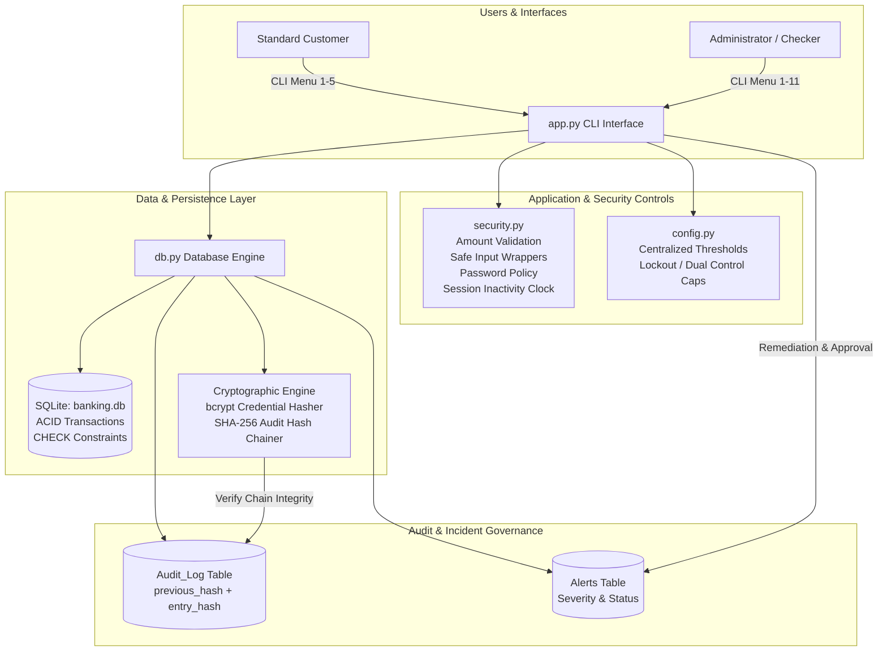

# Secure Banking System

[](https://github.com/ayushkulhari47/secure-banking-system-dbms-cyber/actions/workflows/tests.yml)
[](#)
[](docs/control_mapping.md)
[](#)
[](LICENSE)

A hardened, transactional banking core and cybersecurity compliance demonstration built in Python and SQLite. The project simulates a resilient retail banking ledger incorporating multi-layer defense-in-depth, cryptographic credential protection via salted `bcrypt`, role-based access control (RBAC), monotonic session inactivity timeouts, Maker-Checker dual authorization for high-value fund movements, and a tamper-evident audit trail secured by cryptographic SHA-256 hash chaining. Designed and structured for IT Audit, Cyber Risk & Controls, and Information Security Governance reviews.

---

## 1. Security Features Table

| Feature | What It Does | Control Type | Implementation (File & Function) |
|---|---|---|---|
| **SQL Injection Defense** | Eliminates SQLi vulnerabilities by enforcing parameterized queries (`?`) across all database operations. | **Preventive** | [db.py](db.py) (All SQL queries) |
| **Bcrypt Password Hashing** | Replaces unsalted hashes with salted `bcrypt` (work factor 12), generating unique random 16-byte salts per credential to defeat rainbow tables. | **Preventive** | [db.py:hash_password](db.py#L172), `verify_password` |
| **Password Policy Enforcement** | Requires minimum 8 characters, uppercase, lowercase, numbers, and special symbols for user credentials. | **Preventive** | [security.py:password_meets_policy](security.py#L101) |
| **Brute-Force Account Lockout** | Automatically locks accounts after 3 consecutive failed login attempts (`MAX_FAILED_LOGINS`) and persists state in the database. | **Preventive** | [db.py:increment_failed_attempts](db.py#L210), [app.py:login](app.py#L34) |
| **Amount Bounds Validation** | Application and database-layer bounds checking (`0.01 <= amount <= 1,000,000.00`) rejecting zero, negative, NaN, and infinite inputs. | **Preventive** | [security.py:validate_amount](security.py#L35), [db.py:SCHEMA_SQL](db.py#L69) |
| **Safe Input Exception Handling** | Wraps user CLI input conversion in structured exception blocks, preventing application crashes on non-numeric inputs. | **Preventive** | [security.py:safe_float_input](security.py#L68), `safe_int_input` |
| **Self-Transfer Restriction** | Intercepts attempts to transfer funds to one's own account, preventing artificial audit trail inflation. | **Preventive** | [app.py:do_transfer](app.py#L174) |
| **Inactivity Session Timeout** | Enforces automatic session termination and logout after 300 seconds of inactivity using monotonic system clocks. | **Preventive** | [security.py:Session](security.py#L141), [app.py:menu](app.py#L457) |
| **Role-Based Access Control (RBAC)** | Restricts transaction history to account owners; reserves audit logs, alert consoles, and approval queues strictly to administrators. | **Preventive** | [app.py:view_transactions](app.py#L241), [app.py:view_audit_log](app.py#L270), [app.py:view_alerts](app.py#L287) |
| **Maker-Checker Dual Control** | Quarantines transfers > Rs 50,000 in `pending` state; enforces Segregation of Duties (maker is barred from self-approving). | **Preventive** | [db.py:create_pending_transfer](db.py#L628), `approve_pending_transfer`, [app.py:do_transfer](app.py#L198) |
| **Centralized Security Configuration** | Consolidates all operational thresholds in an auditable configuration module to avoid magic numbers. | **Preventive** | [config.py](config.py) |
| **Comprehensive Event Logging** | Logs all security-relevant events, logins (including unknown emails), financial operations, and administrative overrides. | **Detective** | [db.py:log_action](db.py#L280) |
| **Tamper-Evident Audit Hash Chain** | Links audit log entries via SHA-256 hash chaining (`previous_hash` & `entry_hash`), enabling cryptographic proof of record integrity. | **Detective** | [db.py:compute_audit_hash](db.py#L271), `verify_audit_log_integrity` |
| **Automated Security Alerting** | Raises categorized security alerts with severity ratings (`low`, `medium`, `high`) on brute force and high-value movements. | **Detective** | [db.py:raise_alert](db.py#L380), [app.py](app.py) |
| **Admin Account Unlock** | Provides authorized administrators with a corrective remediation function to unlock locked accounts and reset counters. | **Corrective** | [db.py:unlock_user](db.py#L357), [app.py:manage_locked_users](app.py#L362) |
| **Security Alert Remediation** | Enables security operators to investigate incidents, document corrective actions, and transition alerts to `resolved`. | **Corrective** | [db.py:resolve_alert](db.py#L417), [app.py:manage_alerts](app.py#L397) |

---

## 2. Architecture



---

## 3. Tech Stack

- **Core Programming Language:** Python 3.10+ (tested on Python 3.14)
- **Database Engine:** SQLite 3 (utilizing native standard library `sqlite3` with `PRAGMA foreign_keys = ON` and explicit transaction control `isolation_level=None`)
- **Authentication & Cryptography:** `bcrypt>=4.0.0` (adaptive work factor 12), `hashlib` (SHA-256 hash chaining)
- **Testing Framework:** `pytest>=7.0.0` (74 automated unit, integration, and control tests)
- **CI/CD Pipeline:** GitHub Actions

---

## 4. Folder Structure

```text
secure-banking-system/
├── .github/
│   └── workflows/
│       └── tests.yml             # Automated CI workflow executing pytest on push
├── docs/
│   ├── control_mapping.md        # Traceability matrix mapping code controls to ISO 27001:2022
│   ├── risk_register.md          # 5x5 IT Risk Register evaluating 10 threat scenarios
│   ├── PIA.md                    # Privacy Impact Assessment aligned with India's DPDP Act 2023
│   ├── bcp_dr.md                 # Business Continuity, Disaster Recovery & Incident Response SOP
│   ├── control_testing.md        # Formal IT Audit control testing workpaper (100% effective)
│   ├── security_assessment_report.md # Vulnerability remediation audit report & evidence matrix
│   ├── demo_script.md            # Step-by-step 2-minute interview demonstration script
│   └── presentation_outline.md   # 5-slide presentation deck outline + 8 interview Q&As
├── sql/
│   ├── schema.sql                # Real SQLite DDL matching db.py SCHEMA_SQL (authoritative)
│   ├── procedures.sql            # Legacy MySQL stored procedures (reference only, not used)
│   ├── triggers.sql              # Legacy MySQL triggers (reference only, not used)
│   └── queries.sql               # Diagnostic SQL queries + legacy MySQL seed (reference only)
├── tests/
│   ├── __init__.py
│   ├── test_database.py          # 18 tests for schema constraints, ACID transactions, and rollback
│   ├── test_security_fixes.py    # 42 tests for input safety, amount validation, bcrypt, and RBAC
│   └── test_cyber_controls.py    # 14 tests for Maker-Checker, tamper detection, unlock, and alert resolution
├── app.py                        # Hardened interactive CLI banking frontend and admin console
├── backup_restore.py             # Hot-backup, SHA-256 checksum, and atomic restoration utility
├── config.py                     # Centralized tuneable security configuration parameters
├── db.py                         # Transactional database layer with hash-chained audit logging
├── security.py                   # Pure security validation, safe inputs, password policy, and session
├── requirements.txt              # Pinned external dependencies (bcrypt, pytest)
├── .gitignore                    # Ignores runtime artifacts (banking.db, backups/, cache)
├── LICENSE                       # MIT License
├── SECURITY.md                   # Security vulnerability reporting policy & prototype disclaimer
└── README.md                     # System documentation and compliance report
```

---

## 5. Setup & Run Instructions

Follow these steps to run the application on a clean clone:

### Prerequisites
- Python 3.10 or higher installed.

### Step 1: Clone Repository
```bash
git clone https://github.com/ayushkulhari47/secure-banking-system-dbms-cyber.git
cd secure-banking-system-dbms-cyber
```

### Step 2: Create and Activate Virtual Environment
```bash
# Windows (PowerShell)
python -m venv venv
.\venv\Scripts\Activate.ps1

# Linux / macOS
python3 -m venv venv
source venv/bin/activate
```

### Step 3: Install Dependencies
```bash
pip install -r requirements.txt
```

### Step 4: Run Application (Auto-Seeds Database)
```bash
python app.py
```
*Note: On first startup, `db.init_db()` automatically creates `banking.db`, applies schema constraints, and seeds initial demo users and accounts.*

### Demo Credentials (Strictly for Testing & Demonstrations)
> [!CAUTION]
> The credentials below are hardcoded seeds intended exclusively for interview demonstrations and local development. They must be removed before any production deployment.

| Role | Name | Email | Password | Initial Balance | Account ID |
|---|---|---|---|---|---|
| **Admin / Checker** | Ayush Kulhari | `ayush@bank.com` | `ayush123` | Rs 50,000.00 | `1` |
| **Standard User (Maker)** | Rahul Sharma | `rahul@bank.com` | `rahul123` | Rs 25,000.00 | `2` |
| **Standard User** | Priya Singh | `priya@bank.com` | `priya123` | Rs 15,000.00 | `3` |

---

## 6. Demo Output (Live Terminal Capture)

Below is an authentic execution log captured directly from the hardened banking system demonstrating key cybersecurity controls:

### Scenario A: Authentication & Standard User Session
```text
--- Login ---
Email: rahul@bank.com
Password: rahul123

Welcome Rahul Sharma!  Role: user

--- Banking Menu (USER) --- [session expires in 5m 0s]
1. View Balance
2. Deposit
3. Withdraw
4. Transfer
5. Transaction History
6. Audit Log        (admin only)
7. Security Alerts  (admin only)
8. Logout

Choose: 1

Account ID: 2  |  Balance: Rs25000.00
```

### Scenario B: Negative Amount Exploit Prevention
```text
Choose: 4
Enter destination account ID: 1
Enter transfer amount (Rs): -5000
  [!] Invalid amount: Amount must be greater than Rs0.00 (got Rs-5000.00).
```

### Scenario C: Online Brute-Force Account Lockout
```text
Email: priya@bank.com
Password: wrongpassword
Wrong password! Attempt 1/3

Email: priya@bank.com
Password: wrongpassword
Wrong password! Attempt 2/3

Email: priya@bank.com
Password: wrongpassword
Too many failed attempts -- your account is now locked.

--- Verification: correct password after lockout ---
Email: priya@bank.com
Password: priya123
Account is locked due to multiple failed attempts. Contact admin.
```

### Scenario D: Role-Based Access Control (RBAC) Enforcement
```text
Choose: 6
  [!] Access denied -- admin only.
Choose: 7
  [!] Access denied -- admin only.
```

### Scenario E: Maker-Checker Dual Control on High-Value Transfer (> Rs 50,000)
```text
Choose: 4
Enter destination account ID: 1
Enter transfer amount (Rs): 60000

  [!] Large Transaction Notice (Maker-Checker Control):
      Transfer of Rs60,000.00 exceeds policy limit of Rs50,000.00.
      Transaction #1 has been submitted with status 'pending'.
      Dual-control policy requires an administrator/checker to approve before execution.

Choose: 1

Account ID: 2  |  Balance: Rs25000.00  (unchanged -- funds not deducted)
```

### Scenario F: Cryptographic Audit Log Integrity Verification
```text
--- Login ---
Email: ayush@bank.com
Password: ayush123

Welcome Ayush Kulhari!  Role: admin
Choose: 10

--- Audit Log Cryptographic Integrity Verification ---
  [+] INTEGRITY PASS: All cryptographic SHA-256 hash chains match.
      No records have been modified, deleted, or inserted out of order.
```

### Scenario G: Automated Test Suite Execution
```text
$ python -m pytest tests/ -q
74 passed in 12.80s
```

---

## 7. How to Run Tests

The test suite contains **74 automated tests** covering database constraints, security controls, and cyber risk management features. All tests execute hermetically using in-memory SQLite connections or isolated temporary directories.

```bash
# Run all tests with verbose output
python -m pytest tests/ -v
```

### Test Coverage Summary:
- **`tests/test_database.py` (18 tests):** Schema constraints (`CHECK(balance >= 0)`, `CHECK(amount > 0)`, `role IN ('admin','user')`), email uniqueness, atomic deposit/withdraw/transfer, and transaction rollback verification.
- **`tests/test_security_fixes.py` (42 tests):** Amount validation (rejection of zero, negative, NaN, Inf), safe numeric input wrappers, password complexity validation, session inactivity tracking, self-transfer prevention, bcrypt hash generation/verification, and RBAC privilege checks.
- **`tests/test_cyber_controls.py` (14 tests):** Centralized configuration integrity, cryptographic audit log hash chaining, tamper detection on falsified records or broken links, Maker-Checker pending queues, Segregation of Duties (maker self-approval block), checker approval/rejection, admin account unlock, and alert resolution.

---

## 8. Threat Model

| Threat | Attack Scenario | Implemented Mitigating Control | Code Implementation |
|---|---|---|---|
| **Brute Force Credential Guessing** | Attacker repeatedly guesses passwords via automated script. | Account locks out after 3 failed attempts (`MAX_FAILED_LOGINS`); high-severity alert created; failed attempts counter persisted in database. | [db.py:increment_failed_attempts](db.py#L215), [app.py:login](app.py#L36) |
| **Negative Amount Theft Exploit** | Attacker initiates transfer with negative amount (e.g., `-5000`), draining victim account and artificially increasing attacker balance. | Multi-layer validation: application rejects negative/zero/NaN/Inf values (`MIN_AMOUNT=0.01`); database enforces `CHECK(amount > 0)` and `CHECK(balance >= 0)`. | [security.py:validate_amount](security.py#L35), [db.py:SCHEMA_SQL](db.py#L69) |
| **Privilege Escalation & BOLA** | Standard user accesses admin audit logs, security alerts, or views other users' confidential bank statements. | Role-Based Access Control (RBAC): non-admin requests to sensitive views are denied, and unauthorized attempts are logged to the audit log. | [app.py:view_audit_log](app.py#L270), [app.py:view_alerts](app.py#L287), [app.py:view_transactions](app.py#L241) |
| **Audit Log Tampering & Repudiation** | Malicious insider or intruder modifies or deletes audit log rows in the database to conceal illicit financial actions. | Cryptographic SHA-256 hash chaining: each audit row incorporates the hash of the previous row. `verify_audit_log_integrity()` recalculates hashes and pinpoints modified rows. | [db.py:compute_audit_hash](db.py#L271), `verify_audit_log_integrity` |
| **Unauthorized Large Fund Transfers** | Rogue insider or compromised user attempts large single-point transfer. | Maker-Checker dual control: transfers > Rs 50,000 are placed in `pending` status without deducting funds; Segregation of Duties bars the maker from self-approving. | [db.py:create_pending_transfer](db.py#L628), `approve_pending_transfer`, [app.py:do_transfer](app.py#L198) |

---

## 9. Vulnerabilities Found and Fixed

| # | Vulnerability (Phase 0 Finding) | Before (Vulnerable State) | After (Hardened State) |
|---|---|---|---|
| **1** | **Data Persistence & ACID Compliance** | In-memory Python dictionaries/lists; data lost on application restart; no transaction guarantees. | Persistent SQLite database with foreign keys, schema constraints, and atomic `BEGIN`/`COMMIT`/`ROLLBACK` transactions. |
| **2** | **Weak Credential Storage** | Unsalted SHA-256 (`hashlib.sha256`) vulnerable to precomputed rainbow table attacks. | Adaptive `bcrypt` with work factor 12 and random 16-byte salts generated per password. |
| **3** | **Missing Role-Based Access Control** | Any user could view all customer transactions, audit logs, and security alerts. | Strict RBAC: transaction history scoped to authenticated user account; audit logs and alerts admin-restricted. |
| **4** | **Negative Transfer Theft Exploit** | Negative deposit, withdraw, and transfer amounts accepted, enabling balance inflation and fund theft. | Strict multi-layer validation via `validate_amount()` and DB-level `CHECK(amount > 0)` constraints. |
| **5** | **Application Crash on Invalid Input** | Bare `float(input())` and `int(input())` crashed with unhandled `ValueError` when entering letters or symbols. | Exception-safe wrappers (`safe_float_input()`, `safe_int_input()`) handling invalid formats gracefully. |
| **6** | **Self-Transfer Glitch** | Users could transfer money to their own account, creating redundant records and inflating audit counters. | Application-layer guard checks `from_account == to_account` and rejects self-transfers prior to database calls. |
| **7** | **Unattended Session Hijacking** | Indefinite session lifetime allowed unauthorized access if terminal left unattended. | Monotonic session inactivity timer auto-terminating idle sessions after 300 seconds. |
| **8** | **No Account Lockout Recovery** | Once an account locked after 3 failed attempts, there was no administrative mechanism to unlock it. | Corrective `unlock_user()` function and admin menu console allowing verified identity unlock. |
| **9** | **Mutable Audit Trail** | Audit logs stored in plain records with no integrity verification, vulnerable to insider tampering. | Cryptographic SHA-256 hash chaining (`previous_hash` & `entry_hash`) with automatic tamper pinpointing. |
| **10** | **Single-Point Authority on High-Value Transfers** | Large transfers executed immediately without dual authorization or oversight. | Maker-Checker dual control workflow for transfers > Rs 50,000 with Segregation of Duties enforcement. |

---

## 10. Compliance Documents

All compliance and governance workpapers are located in the [docs/](docs/) directory:

- [docs/control_mapping.md](docs/control_mapping.md): Comprehensive Risk & Control Matrix mapping all system controls to the ISO/IEC 27001:2022 Annex A control set.
- [docs/risk_register.md](docs/risk_register.md): Big-4 style $5 \times 5$ qualitative IT Risk Register evaluating 10 key threat scenarios and residual risks.
- [docs/PIA.md](docs/PIA.md): Privacy Impact Assessment evaluating personal data flows under India's Digital Personal Data Protection (DPDP) Act 2023.
- [docs/bcp_dr.md](docs/bcp_dr.md): Business Continuity, Disaster Recovery objectives (RTO $\le$ 15m, RPO $\le$ 1h), and NIST SP 800-61 Incident Response SOP.
- [docs/control_testing.md](docs/control_testing.md): Formal IT Audit control testing workpaper documenting operating effectiveness across all 74 test cases.
- [docs/security_assessment_report.md](docs/security_assessment_report.md): Formal IT Security Assessment & Vulnerability Remediation Report documenting findings, recommendations, and test verification.
- [docs/demo_script.md](docs/demo_script.md): Step-by-step 2-minute live interview demonstration script with exact inputs and outputs.
- [docs/presentation_outline.md](docs/presentation_outline.md): 5-slide interview pitch deck outline and 8 Big-4 IT audit interview questions & model answers.

---

## 11. Known Limitations and Future Work

To maintain audit transparency, the following technical limitations of this academic prototype are acknowledged:
1. **Console CLI Interface:** The current prototype operates over a local CLI terminal. Production deployment would require an API backend (e.g., FastAPI / Django REST) over TLS 1.3.
2. **Authentication Simplicity:** While bcrypt and password complexity are enforced, enterprise banking mandates out-of-band Multi-Factor Authentication (MFA via TOTP or FIDO2 hardware tokens).
3. **Database Concurrency:** SQLite is well-suited for single-host demonstration and low-concurrency environments. An enterprise deployment would utilize PostgreSQL or MySQL Enterprise with row-level locking and read replicas.
4. **Log Forwarding:** Audit logs are hash-chained within the primary database. In enterprise production, logs should be streamed via TLS to an external Write-Once-Read-Many (WORM) SIEM (e.g., Splunk / Datadog).

---

## 12. Author and License

- **Author:** Ayush Kulhari (B.Tech Computer Science & Engineering)
- **Target Specialization:** Cyber Risk & Compliance / IT Audit / Information Security
- **License:** [MIT License](LICENSE)
