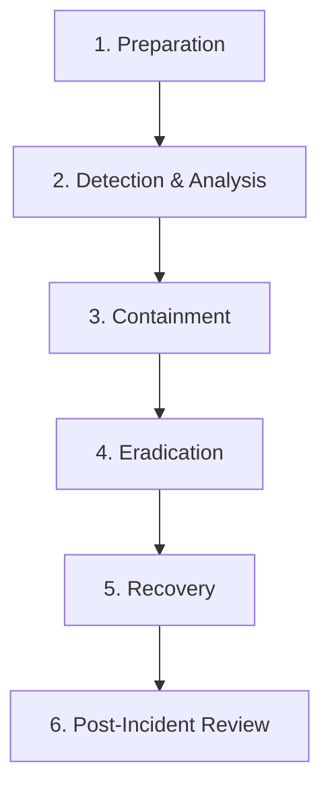

# Business Continuity, Disaster Recovery & Incident Response Plan

**System Name:** Secure Banking System  
**Framework Alignment:** ISO/IEC 27001:2022 (A.5.24–A.5.30), ISO 22301:2019, NIST SP 800-61 Rev. 2  
**Classification:** Operational Resilience & IT General Controls (ITGC)  

---

## 1. Business Continuity & Disaster Recovery Objectives

Financial systems require stringent resilience metrics to ensure business continuity, regulatory compliance (RBI Master Direction on IT / BCP), and transactional integrity.

| Metric | Target Objective | Definition & Operational Justification |
|---|---|---|
| **Recovery Point Objective (RPO)** | **$\le$ 1 Hour** | The maximum acceptable data loss measured in time. In the event of primary database corruption or storage disaster, transactional data loss cannot exceed 60 minutes. Supported by hourly automated online backups and SQLite transaction journal durability. |
| **Recovery Time Objective (RTO)** | **$\le$ 15 Minutes** | The maximum acceptable duration of system downtime from incident declaration to full ledger restoration and operational verification. Supported by localized automated restoration scripts ([backup_restore.py](file:///c:/Users/itsme/Downloads/secure-banking-system/backup_restore.py)). |

---

## 2. Backup Strategy & Technical Architecture

### 2.1 Backup Methodology: Online Hot Backup
Traditional file copying (`cp` / `copy`) of an active SQLite database risks copying partial writes mid-transaction, resulting in corrupted backup files.

To avoid this, [backup_restore.py](file:///c:/Users/itsme/Downloads/secure-banking-system/backup_restore.py) utilizes the **SQLite Online Backup API (`sqlite3.Connection.backup`)**:
1. **Zero Downtime:** Backups run concurrently while the application processes deposits, withdrawals, and transfers without locking tables.
2. **Pre-Backup Integrity Check:** Executes `PRAGMA integrity_check` on the live database before copying. If corruption is detected, the backup aborts immediately to avoid overwriting clean archives with corrupted data.
3. **Cryptographic Checksumming:** Generates a companion `.sha256` checksum file for every backup artifact to verify integrity against bit-rot or offline unauthorized alteration.
4. **Pre-Restoration Safeguard:** Prior to restoring an archived backup over the live database, the utility generates a timestamped pre-restore snapshot (`banking.db.pre_restore_<timestamp>`) to prevent unrecoverable state loss.

---

## 3. Operational Guide: Backup & Restore Script

The system includes a dedicated, dependency-free Python recovery utility: [backup_restore.py](file:///c:/Users/itsme/Downloads/secure-banking-system/backup_restore.py).

### 3.1 Creating a Backup
```bash
python backup_restore.py backup
```
**Output Example:**
```text
[+] Backup completed successfully:
    File:     C:\Users\itsme\Downloads\secure-banking-system\backups\banking_backup_20261022_032753.db
    SHA-256:  f5dd61c8245c993516893b6f3289842e3cb7d7f042a83d9004d7237c00c788d2
```

### 3.2 Listing Available Backups
```bash
python backup_restore.py list
```
**Output Example:**
```text
--- Available Backups ---
  banking_backup_20261022_032753.db (4.0 KB)
  banking_backup_20261022_020000.db (4.0 KB)
```

### 3.3 Restoring from a Backup
```bash
python backup_restore.py restore backups/banking_backup_20261022_032753.db
```
**Execution Sequence:**
1. Validates the SHA-256 checksum against `banking_backup_20261022_032753.db.sha256`.
2. Runs `PRAGMA integrity_check` on the backup file.
3. Creates a pre-restoration snapshot of `banking.db`.
4. Restores the clean database into the production working directory.

---

## 4. Incident Response Standard Operating Procedure (SOP)

Aligned with **NIST SP 800-61 Rev. 2** (Computer Security Incident Handling Guide) and **ISO 27001:2022 A.5.24–A.5.28**:



### Phase 1: Preparation
- Automated controls established in [config.py](file:///c:/Users/itsme/Downloads/secure-banking-system/config.py) (`MAX_FAILED_LOGINS=3`, `LARGE_TXN_THRESHOLD=50000`).
- Integrity verification routines established in [db.py:verify_audit_log_integrity](file:///c:/Users/itsme/Downloads/secure-banking-system/db.py#L313).
- Scheduled backup tasks configured via [backup_restore.py](file:///c:/Users/itsme/Downloads/secure-banking-system/backup_restore.py).

### Phase 2: Detection & Analysis
- **Brute-Force Attack:** Triggered automatically in [app.py:login](file:///c:/Users/itsme/Downloads/secure-banking-system/app.py#L73) when failed attempts $\ge 3$. High-severity alert logged in `Alerts` table.
- **Unauthorized High-Value Movement:** Triggered in [app.py:do_transfer](file:///c:/Users/itsme/Downloads/secure-banking-system/app.py#L198) when transaction $> \text{Rs } 50,000$. Queued for Maker-Checker review.
- **Audit Log Tampering:** Triggered when [app.py:verify_audit_integrity_menu](file:///c:/Users/itsme/Downloads/secure-banking-system/app.py#L432) detects broken SHA-256 hash chains.

### Phase 3: Containment
- **Automated Account Lockout:** System sets `Users.is_locked = 1` immediately, denying further login attempts.
- **Transaction Quarantine:** High-value transfer remains in `pending` state; balance is not decremented.
- **Session Termination:** Idle sessions automatically drop after 300 seconds ([security.py:Session](file:///c:/Users/itsme/Downloads/secure-banking-system/security.py#L141)).

### Phase 4: Eradication
- Administrator logs into CLI, selects Option `7` (**Security Alerts & Remediation**) to inspect the incident description, affected user, and timestamps.
- If an account was maliciously accessed, admin initiates password change via customer verification.
- If pending transfer is fraudulent, checker rejects transaction via Option `8` (**Maker-Checker Approvals**), marking status `rejected` ([db.py:reject_pending_transfer](file:///c:/Users/itsme/Downloads/secure-banking-system/db.py#L740)).

### Phase 5: Recovery
- If database tampering or file corruption is detected:
  1. Halt primary application.
  2. Execute `python backup_restore.py restore <clean_backup_file>`.
  3. Run `python -m pytest` to verify that all 74 unit, database, and control tests pass.
  4. Verify audit integrity via `db.verify_audit_log_integrity()`.
  5. Unlock legitimate accounts via Option `9` (**Unlock User Accounts**).

### Phase 6: Post-Incident Review (Lessons Learned)
- Document incident timeline, root cause, impact assessment, and remediation actions in the formal incident log.
- Admin resolves the open security alert via Option `7` ([db.py:resolve_alert](file:///c:/Users/itsme/Downloads/secure-banking-system/db.py#L399)), permanently documenting the resolution in the tamper-evident audit trail.
