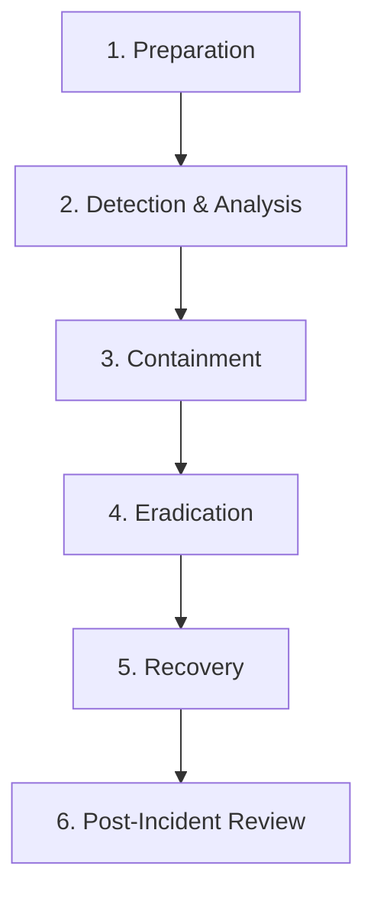

# Business Continuity, Disaster Recovery & Incident Response Notes

**System Name:** Secure Banking System  
**Classification:** Educational Prototype — Backup, Recovery & Incident Response Procedures

---

## 1. Operational Recovery Objectives (Design Targets)

| Metric | Target | Practical Mechanism |
|---|---|---|
| **Recovery Point Objective (RPO)** | `<= 1 Hour` | Periodic hot backups using [`backup_restore.py`](../backup_restore.py) and transactional SQLite/MySQL commits. |
| **Recovery Time Objective (RTO)** | `<= 15 Minutes` | Local snapshot restoration via `python backup_restore.py restore <file>`. |

---

## 2. Backup Strategy & Technical Architecture

### 2.1 SQLite Online Hot Backup
Copying an active SQLite file with `cp`/`copy` mid-transaction can capture torn pages. [`backup_restore.py`](../backup_restore.py) uses `sqlite3.Connection.backup`:
1. **Atomic Snapshot:** Copies pages safely via SQLite's online backup API.
2. **Pre-Backup Integrity Check:** Runs `PRAGMA integrity_check` on the source database before copying.
3. **SHA-256 Sidecar Verification:** Writes a `.sha256` checksum file alongside each backup artifact and verifies it before any restore.
4. **Pre-Restore Snapshot:** Saves a timestamped snapshot (`banking.db.pre_restore_<timestamp>`) before replacing the active SQLite file.

*(For MySQL, `backup_restore.py` uses `mysqldump` / `mysql` CLI with `MYSQL_PWD` passed via environment rather than command-line arguments; live MySQL backup/restore was not tested in this environment.)*

---

## 3. Backup & Restore Usage

```bash
# Create a backup
python backup_restore.py backup

# List available backups
python backup_restore.py list

# Restore from a verified backup
python backup_restore.py restore backups/<backup_file>.db
```

---

## 4. Incident Response Workflow



### Phase 1: Preparation
- Configure thresholds centrally in [`bank/config.py`](../bank/config.py) (`MAX_FAILED_LOGINS=3`, `LARGE_TXN_THRESHOLD=Decimal("50000.00")`).
- Verify audit log verification routines in [`bank/audit.py`](../bank/audit.py) (`verify_audit_log_integrity()`).
- Maintain verified backups via [`backup_restore.py`](../backup_restore.py).

### Phase 2: Detection & Analysis
- **Brute-Force Attack:** [`bank/auth.py`](../bank/auth.py) (`increment_failed_attempts()`) locks the account on the 3rd failed login and creates one high-severity `"Brute Force"` alert atomically.
- **Large Transaction Activity:** [`bank/transactions.py`](../bank/transactions.py) (`_maybe_raise_large_txn_alert()`) creates a high-severity `"Large Transaction"` alert inside the enclosing transaction for successful deposits, withdrawals, or transfer requests above `LARGE_TXN_THRESHOLD`.
- **Audit Log Tampering:** [`main.py`](../main.py) (`verify_audit_integrity_menu()`) calls `audit.verify_audit_log_integrity()` and raises an `"Audit Log Tampering"` alert if verification fails.

### Phase 3: Containment
- **Account Lockout:** Locked accounts (`Users.is_locked = 1`) cannot authenticate, even with valid credentials, until unlocked by an admin.
- **Maker-Checker Quarantine:** Transfers above `LARGE_TXN_THRESHOLD` remain in `'pending'` status without moving account balances.
- **Session Inactivity Timeout:** [`bank/security.py`](../bank/security.py) (`Session`) ends idle CLI sessions after 300 seconds.

### Phase 4: Eradication
- Admin logs in and opens Option `8` (**Security Alerts & Remediation**) to review open alerts.
- If a pending transfer is suspicious or unauthorized, an independent administrator selects Option `9` (**Maker-Checker Approvals**) and rejects it via [`bank/transactions.py`](../bank/transactions.py) (`reject_pending_transfer()`), releasing the reserved funds without moving money.

### Phase 5: Recovery
1. Stop running CLI processes if database corruption or unauthorized offline modification occurred.
2. Restore from a verified backup: `python backup_restore.py restore <clean_backup_file>`.
3. Re-run `python -m pytest tests/ -v` and check audit integrity via CLI Option `11` (**Verify Audit Log Integrity**).
4. Unlock affected legitimate users via CLI Option `10` (**Unlock User Accounts** -> [`bank/auth.py`](../bank/auth.py) `unlock_user()`).

### Phase 6: Post-Incident Review
- Transition reviewed alerts from `reviewed` to `closed` via CLI Option `8` ([`bank/alerts.py`](../bank/alerts.py): `review_alert()`, `close_alert()`), recording resolution notes.
