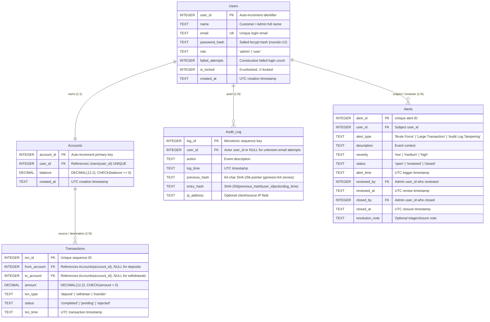

# Database Entity-Relationship (ER) Architecture & Data Dictionary

**System Name:** Secure Banking System  
**Database Design:** Normalized 3NF Relational Schema with Foreign Keys, `DECIMAL(12,2)` Money Columns, Audit Triggers, and SHA-256 Hash Chaining (Authoritative DDL in [`bank/db.py`](../bank/db.py))

---

## 1. Visual Entity-Relationship Diagram (Mermaid)

---

## 2. Relational Integrity & Trigger Rules

1. **Users (1) <-> Accounts (1):** Enforced via `user_id ... UNIQUE REFERENCES Users(user_id)`. Balances use `DECIMAL(12,2)` with non-negative checks (`balance >= 0`, plus `ROUND(balance, 2) = balance` on SQLite).
2. **Accounts (1) <-> Transactions (0..N):** Captures deposits (`from_account IS NULL`), withdrawals (`to_account IS NULL`), and transfers (`from_account` and `to_account`), enforcing `amount > 0` and 2-decimal precision.
3. **Audit_Log Triggers & Hash Chain:**
   - `after_accounts_balance_update`: Automatically inserts a hash-chained `Audit_Log` entry on every `Accounts.balance` update (`sha256_hex` UDF on SQLite; `SHA2(..., 256)` on MySQL) and aborts if the existing chain tail is corrupt or unhashed.
   - `prevent_audit_log_update` / `prevent_audit_log_delete`: Block every `UPDATE` and `DELETE` on `Audit_Log`.
4. **Alerts Lifecycle:** Supports `open` -> `reviewed` -> `closed` transitions with reviewing/closing administrator attribution (`reviewed_by`, `closed_by`, `resolution_note`).
