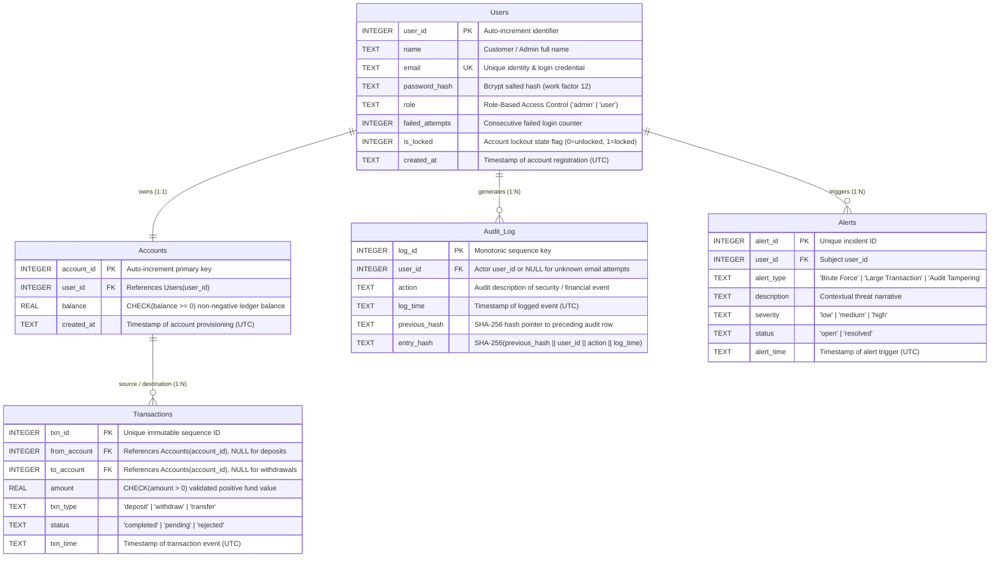

# Database Entity-Relationship (ER) Architecture & Data Dictionary

**System Name:** Secure Banking System (DBMS + Cybersecurity IT Audit Prototype)  
**Database Standards:** 3NF Relational Architecture, Foreign Key Referencing, Cryptographic Hash Chaining  
**Author:** Ayush Kulhari  

---

## 1. Visual Entity-Relationship Diagram (Mermaid)

---

## 2. Relational Cardinality & Integrity Rules

1. **Users (1) $\longleftrightarrow$ Accounts (1):**
   - Each customer is allocated one primary ledger account.
   - Enforced by foreign key `Accounts.user_id REFERENCES Users(user_id)` with non-negative check `balance >= 0`.
2. **Users (1) $\longleftrightarrow$ Audit_Log (0..N):**
   - Every system activity, successful login, failed authentication, and admin action generates an audit entry.
   - `user_id` allows `NULL` values to record unauthenticated probe attempts (e.g., failed logins with unknown emails) for forensic tracking without violating relational constraints.
3. **Users (1) $\longleftrightarrow$ Alerts (0..N):**
   - Security incidents (3 consecutive failed logins, high-value transfers $> \text{Rs } 50,000$, or audit chain tampering) link directly to the subject account.
4. **Accounts (1) $\longleftrightarrow$ Transactions (0..N):**
   - An account can act as sender (`from_account`), recipient (`to_account`), or both across historical transactions.
   - Dual control transactions remain in status `pending` until approved by an independent checker.

---

## 3. Cyber-Specific Columns & Threat Mitigation

| Column | Table | Data Type | Security / Cyber Objective |
|---|---|---|---|
| `password_hash` | `Users` | `TEXT` | Stores bcrypt hash with 16-byte random salt and work factor 12, defeating offline precomputed rainbow table attacks. |
| `failed_attempts` | `Users` | `INTEGER` | Monotonically tracks failed password attempts; triggers account lock when reaching `MAX_FAILED_LOGINS` (3). |
| `is_locked` | `Users` | `INTEGER` | Persistent lockout flag; prevents brute-force credential stuffing attacks even across server restarts. |
| `balance` | `Accounts` | `REAL` | Hard schema constraint `CHECK(balance >= 0)` prevents overdraft and protects against race-condition TOCTOU exploits. |
| `amount` | `Transactions` | `REAL` | Hard schema constraint `CHECK(amount > 0)` prevents negative-amount fund theft exploits at the database level. |
| `status` | `Transactions` | `TEXT` | Maker-Checker workflow state (`completed`, `pending`, `rejected`); holds transfers $> \text{Rs } 50,000$ for dual authorization. |
| `previous_hash` | `Audit_Log` | `TEXT` | Cryptographic SHA-256 pointer to preceding audit row (genesis block initialized with 64 zeroes). |
| `entry_hash` | `Audit_Log` | `TEXT` | `SHA-256(previous_hash \|\| user_id \|\| action \|\| log_time)`; provides mathematical tamper-evidence. |
| `severity` | `Alerts` | `TEXT` | Incident triage rating (`low`, `medium`, `high`) aligned with NIST SP 800-61 Rev. 2. |
| `status` | `Alerts` | `TEXT` | Remediation lifecycle tracker (`open`, `resolved`) ensuring every raised threat is formally investigated and closed. |

---

## 4. Normalization Justification

- **1NF (First Normal Form):** Every cell holds an atomic, single value (no multi-valued attributes, no repeating groups).
- **2NF (Second Normal Form):** In 1NF and every non-key attribute is fully functionally dependent on the entire primary key (no partial key dependencies).
- **3NF (Third Normal Form):** In 2NF and no non-key attribute is transitively dependent on another non-key attribute. For instance, customer details (`name`, `email`) remain in `Users`, while financial balances reside strictly in `Accounts`.
